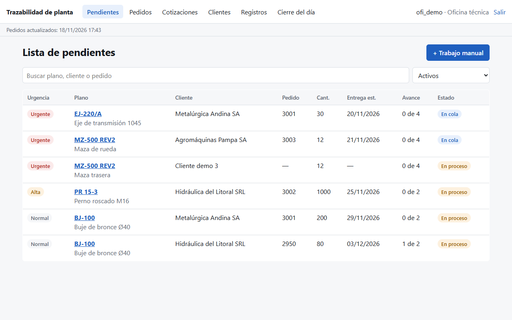
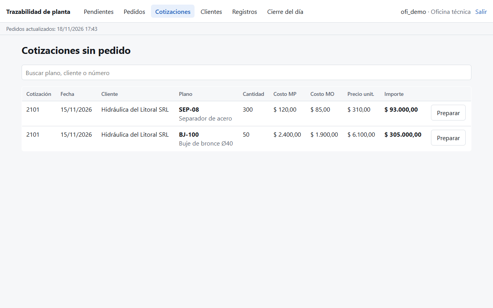
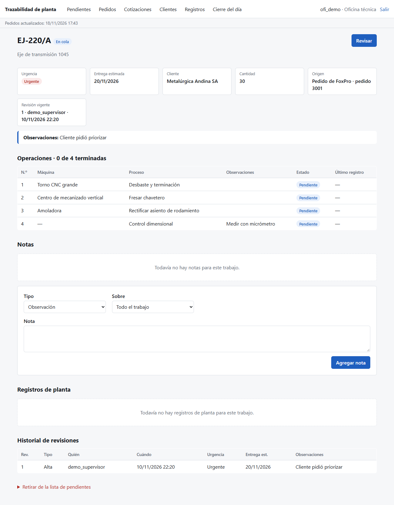
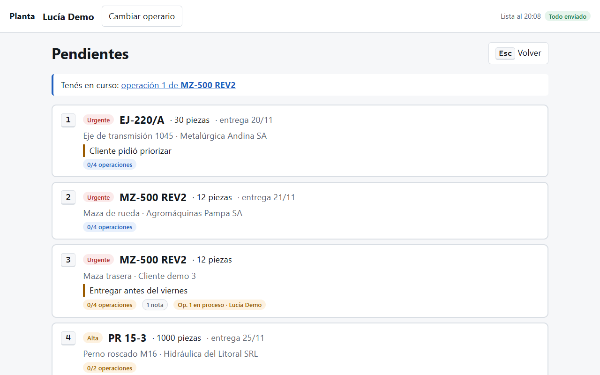
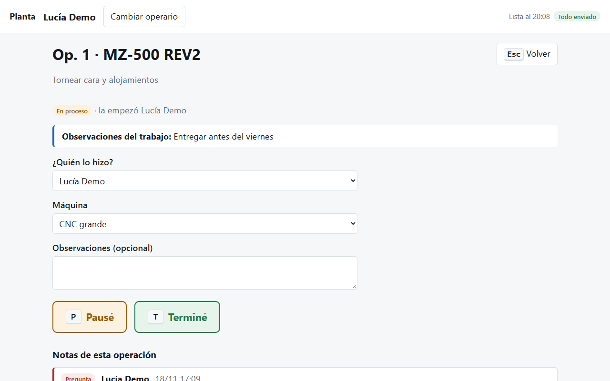
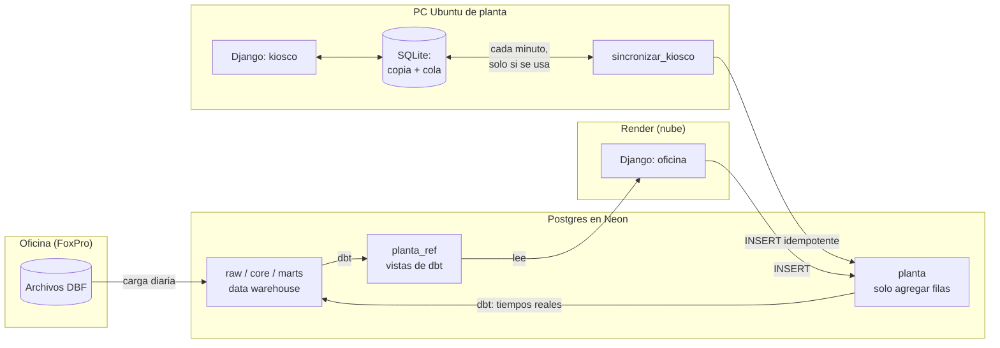
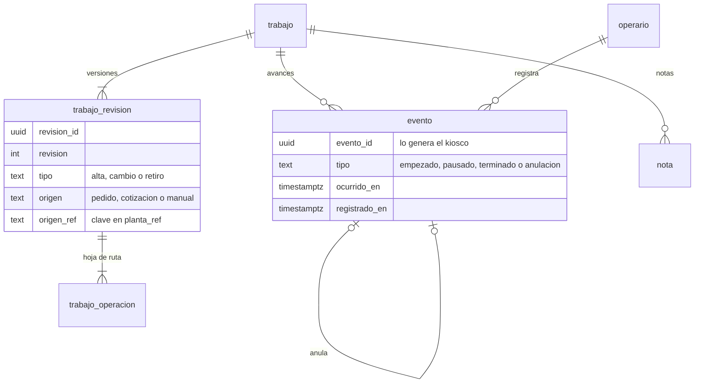

# Trazabilidad de planta

Registro del avance de producción en una tornería CNC. La oficina arma la lista
de trabajos pendientes a partir de los pedidos y cotizaciones del sistema de
gestión (FoxPro), y los operarios registran en un kiosco qué operación empiezan,
pausan y terminan. Todo queda como historia que no se edita: la base para medir
tiempos reales y cruzarlos con los pedidos en el data warehouse.

[](https://github.com/SebMun33/trazabilidad-planta/actions/workflows/ci.yml)

> Todas las capturas y datos de este repositorio son **ficticios**.

## El problema

- Los pedidos y cotizaciones viven en un sistema FoxPro 2.6 de los años 90, que
  no registra qué pasa en el taller.
- El avance se seguía de palabra o en papel: no se sabía qué operación estaba en
  qué máquina, quién la hizo ni cuánto tardó.
- En planta hay una PC vieja (Ubuntu, 4 GB de RAM) y la conexión a internet no
  siempre es buena. Nadie quiere tipear contraseñas con las manos engrasadas.

## Qué hace

| Oficina (web) | Kiosco de planta |
|---|---|
| Ver pedidos con saldo y cotizaciones en espera, con costos y precios (solo roles autorizados) | Elegir operario escribiendo el nombre, sin contraseña |
| Pasar renglones a la lista de pendientes, ajustando la hoja de ruta sugerida | Ver los trabajos en orden de urgencia |
| Seguir el estado de cada trabajo y operación | Registrar «Empecé», «Pausé», «Terminé» con atajos de teclado |
| Responder notas y preguntas de planta | Dejar observaciones, sugerencias y preguntas |
| Anular registros erróneos y cerrar el día | Deshacer el último registro durante 60 segundos |
| Ficha de cada cliente con lo que tiene abierto | Funciona sin conexión y envía cuando vuelve |

### Oficina



| Cotizaciones con importes | Detalle de un trabajo |
|---|---|
|  |  |

### Kiosco

| Trabajos del operario | Registrar una operación |
|---|---|
|  |  |

## Arquitectura



- **Una sola base, esquemas separados.** La app lee únicamente las vistas de
  `planta_ref` (el contrato con el warehouse, en
  [`docs/integracion_dw.md`](docs/integracion_dw.md)) y escribe solo en
  `planta`. El warehouse cruza eventos y pedidos con un `JOIN`, sin copias.
- **Solo se agregan filas.** Un trigger y los permisos del rol impiden `UPDATE`
  y `DELETE`. Los errores se corrigen con anulaciones y los cambios con
  revisiones nuevas.
- **El estado se calcula a partir de los eventos**, con una función pura que
  comparten la oficina y el kiosco.
- **El kiosco sigue funcionando sin internet**: lee una copia local y graba en
  una cola que un proceso aparte envía con claves generadas en el kiosco, así
  reenviar es inofensivo. Solo consulta Neon mientras alguien lo usa, para que
  el cómputo pueda suspenderse.

### Modelo de datos (`planta`)



## Roles

| Rol | Puede |
|---|---|
| Operario | Registrar avances y escribir notas, solo desde el kiosco (sin contraseña) |
| Oficina técnica | Preparar pendientes, notas, anular registros, cerrar el día, ver importes |
| Contabilidad | Ver trabajos e importes (solo lectura) |
| Staff | Todo, incluida la administración de usuarios |

Los operarios **nunca** ven precios ni costos: el kiosco no recibe esos datos.
Ver [decisión 0007](docs/decisiones/0007-roles-y-acceso.md).

## Stack

Python 3.12 · Django 5.2 LTS · Postgres 18 (Neon) · psycopg 3 · HTMX ·
WhiteNoise · Gunicorn · SQLite (kiosco) · dbt (en el repo del warehouse) ·
uv · ruff · pytest-django · GitHub Actions · Render · systemd.

Sin frameworks de JavaScript: el HTML lo arma Django y HTMX actualiza partes de
la página. El kiosco suma un archivo de JS chico para los atajos de teclado.

## Desarrollo local

Requisitos: [uv](https://docs.astral.sh/uv/) y Docker.

```bash
cp .env.example .env            # y completar DJANGO_SECRET_KEY
docker compose up -d --wait     # Postgres local con roles, esquemas y vistas de ejemplo
uv sync
bash ops/migrar.sh              # migraciones con el rol dueño
DJANGO_DB_OWNER=1 uv run python manage.py seed_demo   # datos FICTICIOS
uv run python manage.py createsuperuser
uv run python manage.py runserver
```

- Oficina: <http://localhost:8000/>
- Kiosco: <http://localhost:8000/kiosco/> (en desarrollo se publica en el mismo
  servidor; en producción corre solo en la PC de planta).

### Tests y calidad

```bash
uv run pytest                   # siempre contra el Postgres local, nunca Neon
uv run ruff format --check . && uv run ruff check .
```

El CI corre lint, `makemigrations --check`, los tests contra Postgres 18 y
`check --deploy` con la configuración de oficina y la de planta.

## Despliegue

- **Oficina:** Render (plan gratuito), definido en [`render.yaml`](render.yaml).
  Guía en [`docs/despliegue_oficina.md`](docs/despliegue_oficina.md).
- **Kiosco:** PC Ubuntu de planta con systemd, Chromium en modo kiosco y
  respaldo diario. Guía en [`docs/instalacion_ubuntu.md`](docs/instalacion_ubuntu.md).

## Decisiones

| N.º | Decisión |
|---|---|
| [0001](docs/decisiones/0001-solo-agregar-filas.md) | El registro de planta solo agrega filas |
| [0002](docs/decisiones/0002-eventos-en-vez-de-estados.md) | Eventos en vez de estados |
| [0003](docs/decisiones/0003-base-compartida-en-neon.md) | Base compartida con el data warehouse, en Neon |
| [0004](docs/decisiones/0004-pendientes-preparados-por-la-oficina.md) | La oficina prepara la lista de pendientes |
| [0005](docs/decisiones/0005-esquemas-y-search-path.md) | Esquemas de Postgres, DDL explícito y `search_path` |
| [0006](docs/decisiones/0006-kiosco-sin-conexion.md) | Kiosco que sigue funcionando sin conexión |
| [0007](docs/decisiones/0007-roles-y-acceso.md) | Roles, ingreso por nombre y notas |

## Próximos pasos

- Carga automática diaria desde FoxPro y botón para cargar una cotización
  recién guardada.
- Avisos por correo y WhatsApp a la oficina cuando planta deja una pregunta.
- Tablero de tiempos reales contra los estimados de la hoja de ruta (en dbt).

## Licencia

[MIT](LICENSE)
