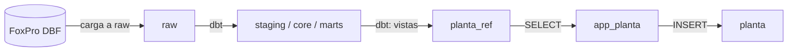

# Integración con el data warehouse (`planta_ref`)

La app **no lee FoxPro ni las tablas del data warehouse**. Lee únicamente cinco
vistas del esquema `planta_ref`, que publica el proyecto dbt del warehouse. Esas
vistas son el **contrato**: mientras respeten nombres y tipos de columnas, el
warehouse puede reorganizarse por dentro sin tocar la app.

- Las vistas las crea el rol de dbt (`neondb_owner` por defecto; ver
  `ops/01_neon_planta.sql`, variable `rol_dbt`). Los *default privileges* de
  ese script hacen que `app_planta` y `app_planta_owner` puedan leer todo lo
  que dbt cree en `planta_ref`: **no hace falta dar permisos a mano**.
- Las vistas corren con los permisos de su dueño (no `security_invoker`), así
  que `app_planta` no necesita acceso a `marts`, `core` ni `raw`.
- La app nunca escribe en `planta_ref`, y dbt nunca escribe en `planta`.

## Contrato

Todas las claves son `text`. Las cantidades son `numeric`.

### `planta_ref.maquinas`

| Columna | Tipo | Notas |
|---|---|---|
| `maquina_id` | integer | clave (código de FoxPro) |
| `nombre` | text | descripción completa |
| `nombre_corto` | text, nullable | descripción breve |

### `planta_ref.pedidos_pendientes`

Renglones de pedido con cantidad pendiente de entrega.

| Columna | Tipo | Notas |
|---|---|---|
| `pedido_linea_id` | text | clave **estable** entre corridas de dbt; la app la guarda en `trabajo_revision.origen_ref` |
| `pedido_id` | integer | |
| `orden_compra` | text, nullable | |
| `fecha_pedido` | date, nullable | |
| `cliente_id` | integer, nullable | |
| `cliente` | text, nullable | razón social |
| `plano` | text | |
| `plano_descripcion` | text, nullable | |
| `cantidad_pedida` | numeric | |
| `cantidad_entregada` | numeric | |
| `cantidad_pendiente` | numeric | siempre `> 0` |

### `planta_ref.cotizaciones_sin_pedido`

Renglones cotizados que todavía no originaron un pedido y siguen vigentes.

| Columna | Tipo | Notas |
|---|---|---|
| `cotizacion_linea_id` | text | clave **estable** (se guarda en `origen_ref`) |
| `cotizacion_id` | integer | |
| `fecha_cotizacion` | date, nullable | |
| `cliente_id` | integer, nullable | |
| `cliente` | text, nullable | |
| `plano` | text | |
| `plano_descripcion` | text, nullable | |
| `cantidad` | numeric | |

### `planta_ref.rutas`

Hoja de ruta estándar de cada plano: base para sugerir las operaciones de un
trabajo. **Un plano puede repetir el número de operación** (dos secuencias en
la misma hoja), por eso la clave usa el renglón y el orden es por renglón.

| Columna | Tipo | Notas |
|---|---|---|
| `ruta_id` | text | clave: `plano#renglon` |
| `plano` | text | |
| `renglon` | integer | orden dentro de la hoja de ruta |
| `operacion_nro` | integer | número de operación de FoxPro (puede repetirse) |
| `maquina_id` | integer, nullable | |
| `descripcion` | text, nullable | |
| `piezas_hora` | numeric, nullable | |

Las filas de **preparación de máquina** (descripción `*PM…`) no se publican:
no son procesos sobre la pieza.

### `planta_ref.ultima_publicacion`

Una fila. La oficina la muestra como «Datos de FoxPro al …».

| Columna | Tipo | Notas |
|---|---|---|
| `publicado_en` | timestamptz | fin de la última carga correcta de FoxPro |

## Implementación en dbt

Los modelos viven en el proyecto dbt del warehouse, en `models/planta_ref/`,
materializados como vistas en el esquema `planta_ref`:

| Vista | Fuente | Filtro |
|---|---|---|
| `maquinas` | `dim_maquina` | sin el miembro «desconocido» |
| `pedidos_pendientes` | `mart_seguimiento_pedidos` | `cantidad_pendiente > 0` |
| `cotizaciones_sin_pedido` | `mart_cotizaciones` | `estado_cotizacion = 'En espera'` |
| `rutas` | `int_rutas__numeradas` | sin preparaciones |
| `ultima_publicacion` | source `raw._cargas` | `estado = 'ok'` |

Las claves de pedidos y cotizaciones son las claves sustitutas del warehouse
(hash de pedido + plano y de cotización + plano): no cambian entre corridas.

### Dónde se publica

| Entorno | Base | Cómo |
|---|---|---|
| Desarrollo y tests | Postgres local | `ops/dev/planta_ref_demo.sql` imita el contrato con datos ficticios |
| Rama Neon `dev-planta` | copia de main | `dbt build --target dev_planta -s path:models/planta_ref` |
| Producción | Neon main | corrida de dbt de producción (cuando se despliegue la app) |

El target `dev_planta` lee el host de su propia variable y usa los nombres de
esquema exactos (`planta_ref`, no `dev_planta_ref`), porque la rama es una
copia aislada. Así nunca se usa el target de producción para probar.

## Cambios al contrato

Un cambio de columnas se hace en este orden: vista de demo
(`ops/dev/planta_ref_demo.sql`) + modelo Django (`planta/models.py`) + tests en
este repo; después el modelo dbt. Agregar columnas al final es compatible;
renombrar o quitar columnas rompe la app.
